# Separation Creek Krillion

A rare-answer trivia party game for one weekend down the Great Ocean Road. One screen on the TV, everyone else on their phones. Seven open prompts, about 20 seconds each, one answer per prompt. The rarer your answer among the people in the room, the deeper you go down Separation Creek: from the Great Ocean Road bridge, through the rock pools, out across the beach, to the creek mouth.

Built for a crew of about 20 playing at the same time. Runs on a laptop on the house Wi-Fi with no internet, or in the cloud for a few dollars. See [DEPLOYMENT.md](./DEPLOYMENT.md) for the step-by-step setup.

> This is a one-off game for a single weekend. It borrows the rare-answer idea from Krillion (krillion.io) and re-themes it. It is not affiliated with Krillion.

## Screenshots

Taken from a real 20-player game by `node scripts/e2e.cjs` (host at 1920×1080, phone at 390×844).

| Host: lobby with QR code | Host: prompt |
|---|---|
| 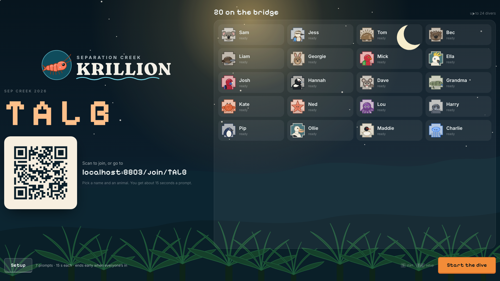 | 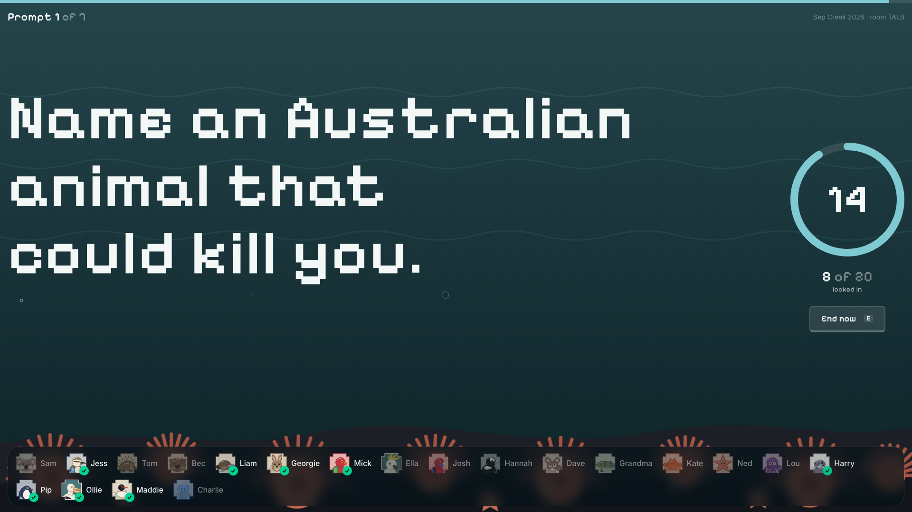 |

| Host: reveal, rarest first | Host: after rejecting an answer |
|---|---|
| 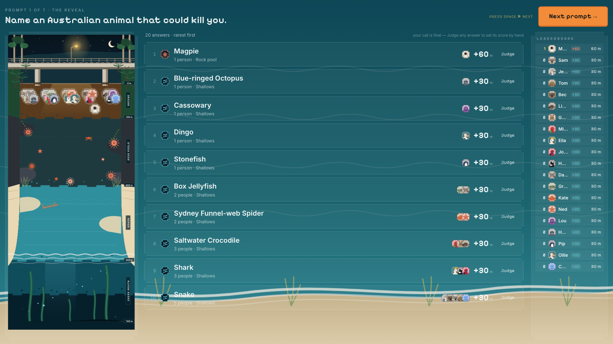 | 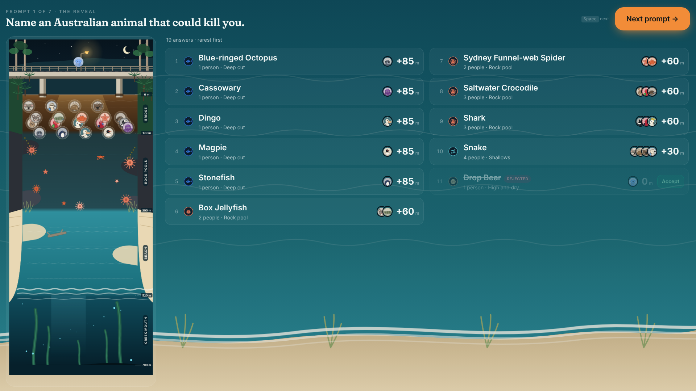 |

| Host: final results | Host: setup drawer |
|---|---|
| 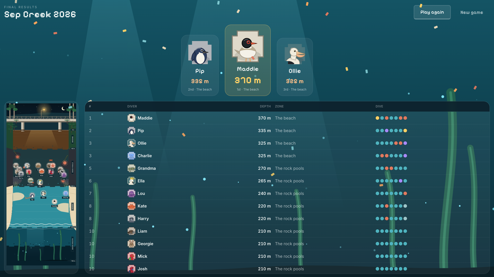 | 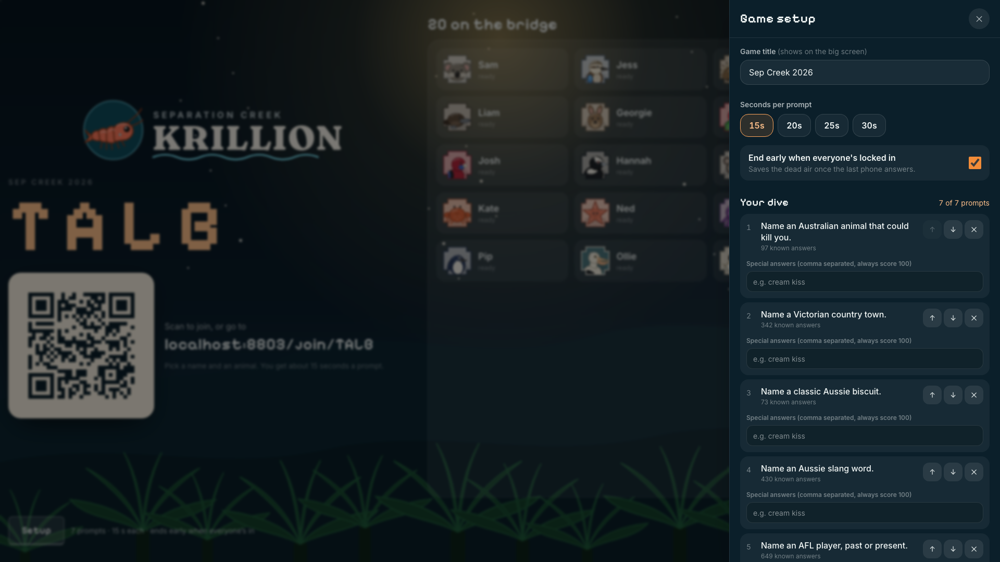 |

| Phone: join | Phone: prompt | Phone: locked in |
|---|---|---|
| 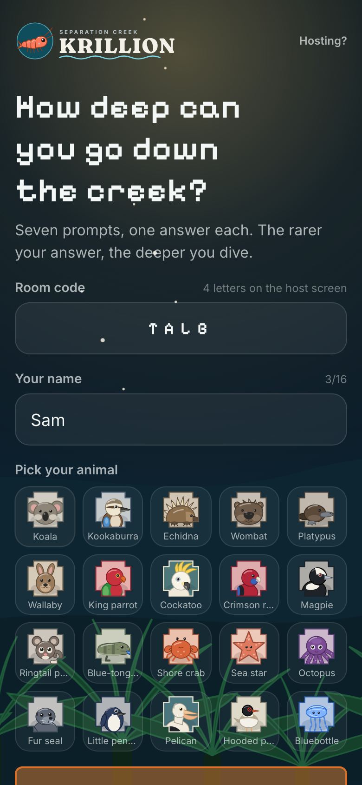 | 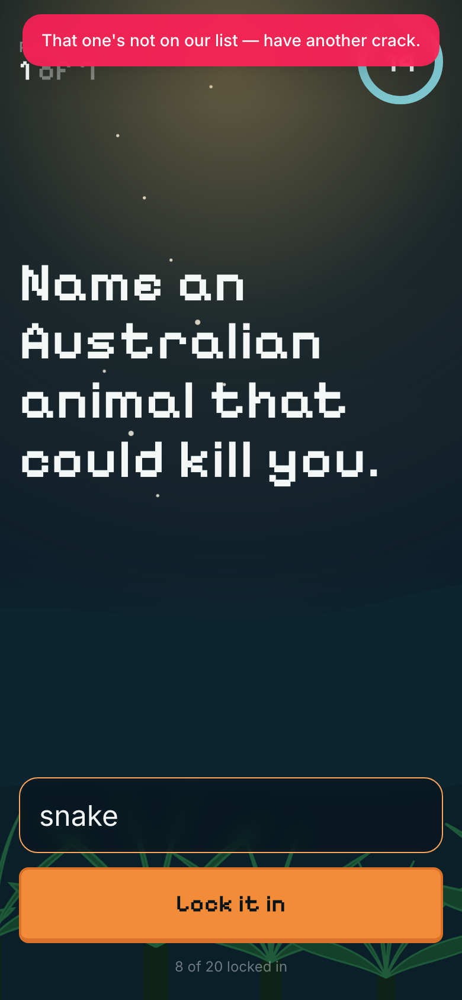 | 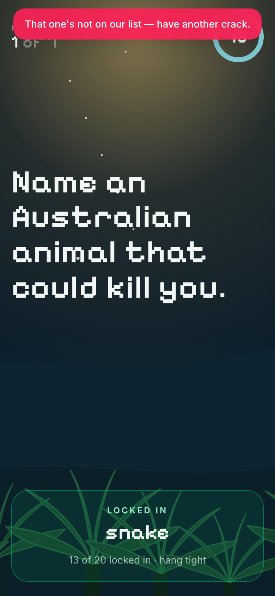 |

| Phone: reveal | Phone: results |
|---|---|
| 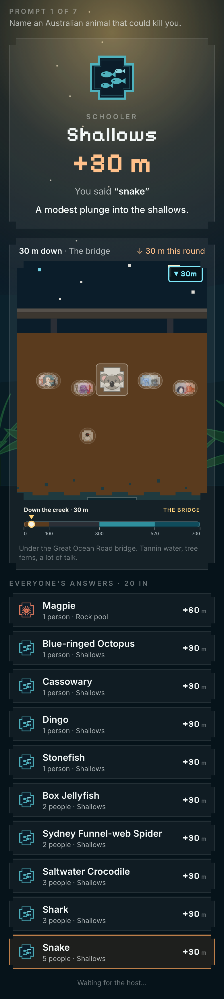 | 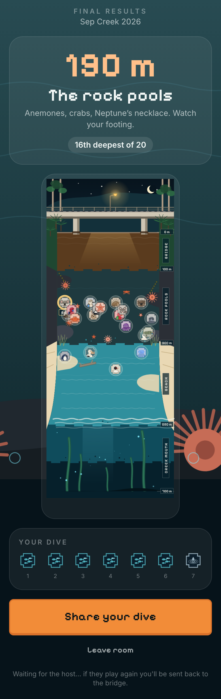 |

## How it plays

1. **Host** opens `/host` on the laptop plugged into the TV. A four-letter room code and a QR code appear.
2. **Players** scan the QR code (or type the code at `/`), pick a name and an animal, and land on the bridge.
3. The host presses **Start**. Each prompt is shown on the TV and on every phone with a 20-second countdown. Everyone types one answer and locks it in.
4. **Reveal.** Answers are grouped (spelling variants and plurals are merged), and each group is scored by how many people in the room said it:

   | Tier | Krillion name | Who said it | Metres |
   |---|---|---|---|
   | Puddle | Plankton | 30 % of the room or more | 10 |
   | Shallows | Schooler | 20 % to 30 %, or two people in a room of 5 to 7 | 30 |
   | Rock pool | Rare | under 20 %, or two people in a room of 8 or more, or an answer the game did not recognise that only you gave (until the host vouches for it) | 60 |
   | Deep cut | Deep Cut | only you, and the game recognised it or the host vouched for it | 85 |
   | One in a Krillion | One in a Krillion | only you, and a genuine deep cut (with at least four answers in the round), or one of Sam's special answers | 100 |
   | High and dry | no dive | no answer, or the host knocked it back | 0 |

   One point is one metre. Seven perfect answers reach the creek mouth at 700 m.

   **The answer's own rarity caps its score.** Every bank entry carries an
   impartial rarity grade (`common`/`uncommon`/`rare`/`deep`), assigned from
   Wikipedia pageview data weighted toward Australian knowledge
   (`npm run bank:grade`). The crowd can drag a score down, but never lift a
   well-known answer above its grade: a lone `common` answer is a Schooler
   (30) at best, a lone `uncommon` a Rare (60), a lone `rare` a Deep Cut
   (85), and only a genuine `deep` answer said alone is One in a Krillion.

   **Obvious answers never score.** Entries flagged `"obvious": true` in the bank (Lorne, Wye River, Separation Creek and Kennett River on the two town prompts — the places you can see from the dinner table or the koala stop two bends south) are pinned to a puddle (10 m) no matter how few people say them, and show a **too obvious** tag on the reveal. A host special answer still trumps the flag.
5. **Only answers the game recognises can be locked in.** Anything not in the curated bank (after typo-tolerant matching) bounces straight back — the phone shows *"not on our list — have another crack"* and the player can keep trying until the timer runs out. Host special answers are always accepted, and closest-to-the-pin prompts accept any number. The banks are deliberately generous (spelling variants, nicknames, plurals), so an honest answer almost always lands. On the reveal the host can **Judge** any answer — pin it to any tier by hand, reject it to zero, or return it to automatic scoring; the host's call trumps everything and every phone re-scores live.
6. After seven prompts: podium, full leaderboard, a creek cross-section with everyone at their final depth, and a share card for the group chat.

### The zones

| Metres | Zone |
|---|---|
| 0 to 100 | The bridge |
| 100 to 300 | The rock pools |
| 300 to 520 | The beach |
| 520 to 700 | The creek mouth |

### Special answers

In the host's Setup drawer, any prompt can carry "special answers": answers that mean something to Sam and score One in a Krillion no matter how many people say them. The brief's example, a cream kiss from the Freshwater Creek Bakery, is pre-loaded.

### Closest to the pin

Three number prompts (population of Separation Creek, length of the Great Ocean Road, holes at RACV Torquay) are scored by closeness instead of rarity: closest is One in a Krillion, second is Deep cut, third is Rock pool, the top half is Shallows, the rest Puddle. They are marked as drafts and off by default; the host can switch them on in Setup.

## Prompts

Nine starter prompts are on by default, with seven selected. Twelve local-flavour prompts (Freshwater Creek Bakery, the Wye River pub, Ipsos, Totti's, RACV Torquay, and so on) ship as drafts the host can turn on. Every prompt has a curated answer bank in `server/data/bank/` used to merge variants and spot deep cuts; anything not in the bank is still accepted by default and flagged for the host.

## Quick start (developer)

```bash
cd games/separation-creek-krillion
npm install
npm run dev          # server on :8787, client on :5173 (proxied)
```

Open http://localhost:5173/host in one tab and http://localhost:5173 in another (or on your phone using your laptop's IP).

Production build and run:

```bash
npm run build
npm start            # serves the built client and the WebSocket on :8787
```

Useful scripts:

| Command | What it does |
|---|---|
| `npm test` | Unit tests for scoring, room state machine, protocol and answer banks |
| `npm run typecheck` | Type-checks server and client |
| `npm run simulate -- ws://localhost:8787/ws 20` | Plays a full game with 20 bots against a running server (no browser needed) |
| `node scripts/e2e.cjs http://localhost:8787` | Full browser run: host screen + one phone + 19 bots, screenshots into `docs/screenshots/`. Needs `npm i -D playwright && npx playwright install chromium` |
| `npm run bank:check` | Validates every answer-bank file and prints a summary |
| `npm run db:migrate` | Applies database migrations (only needed if `DATABASE_URL` is set; the server also runs them on boot) |

## Layout

```
games/separation-creek-krillion/
├── shared/          types, scoring rules, theme (tiers, zones, avatars) — used by both sides
├── server/          Hono HTTP + ws WebSocket server, room state machine, answer banks, optional Postgres
│   └── data/bank/   one JSON answer bank per prompt
├── client/          React + Vite app: player phone screens and host TV screens
│   └── src/art/     the illustration pack: creek scene, 20 avatars, tier badges, backdrops
├── scripts/         simulate.ts (20-bot game), check-bank.ts
├── docs/            screenshots
├── Dockerfile, docker-compose.yml
└── DEPLOYMENT.md    how to run it for 20 people
```

## Configuration

Copy `.env.example` to `.env`. Everything is optional.

| Variable | Default | Purpose |
|---|---|---|
| `PORT` | `8787` | Port for the web server and WebSocket |
| `PUBLIC_URL` | derived from the request | URL printed on the host screen and encoded in the QR code |
| `DATABASE_URL` | unset | Postgres connection string. When set, rooms, players and answers are stored and in-progress rooms survive a restart |
| `ALLOWED_ORIGINS` | unset | Extra origins allowed to open a WebSocket, comma separated. By default a browser's origin must match the server's own host or `PUBLIC_URL`; set `PUBLIC_URL` when behind a proxy or custom domain |
| `HOST_PIN` | unset | If set, creating a room requires this PIN. Recommended on a public URL; six or more characters |
| `PGSSL` | from the URL | `require`, `no-verify` or `disable`, when a hosted Postgres needs something other than what `sslmode` in the URL says |
| `PGSSL_CA` | unset | Path to a CA certificate file for Postgres TLS |
| `LOG_LEVEL` | `info` | `debug`, `info`, `warn` or `error` |

## Licence

Same as the rest of this repository: provided as is, do what you like with it.
